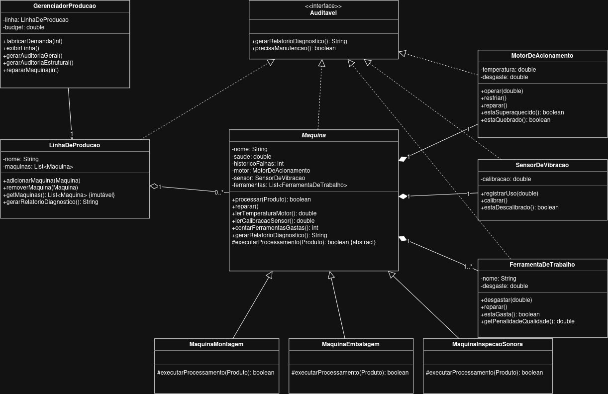

# # Fábrica Harmonia Tarefa 5 (MC322)

Simulador de uma fábrica de instrumentos musicais desenvolvido para a disciplina MC322 (Programação Orientada a Objetos). O sistema permite cadastrar demandas, aplicar estratégias de produção, gerenciar o estoque de matérias-primas e acompanhar a manutenção das máquinas.

## UML


## Como Executar

O projeto utiliza o Gradle Wrapper, não sendo necessário instalar o Gradle globalmente.

No Linux / macOS:
```bash
./gradlew build    # Compila
./gradlew run      # Executa
./gradlew javadoc  # Gera a documentação 
```

No windows
```cmd
gradlew.bat build
gradlew.bat run
gradlew.bat javadoc
```

## Autor

Arthur Lopes Pessoa
